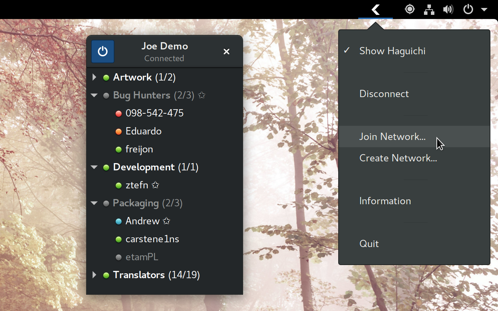

# Haguichi Indicator for GNOME Shell

Lets you control [Haguichi](https://haguichi.net) directly from the system status area in GNOME Shell.

## Screenshot

## Installation

### Via the GNOME Shell Extensions website

### Manual Installation

1. Download the source code as zip from GitHub and extract it.
2. Copy the folder `gse-haguichi-indicator@ztefn.github.com` from the extracted archive to `~/.local/share/gnome-shell/extensions/`.
3. Log out and log back into your session.
4. Enable the extension by running the command `gnome-extensions enable gse-haguichi-indicator@ztefn.github.com` inside a terminal.
